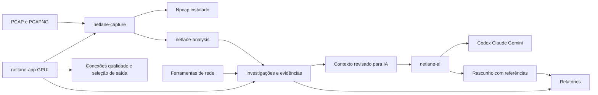

# NetLane como aplicação de diagnóstico de rede com IA

Direção definida em 10/10/2026: reunir ferramentas de rede, captura de pacotes,
análise assistida e relatórios verificáveis. O técnico usa o aplicativo no PC
com falha ou tráfego suspeito, escolhe as evidências e investiga principalmente
com **Codex**. Claude e Gemini são adaptadores opcionais futuros.

O monitor de conexões, a qualidade por interface e a seleção de saída por
aplicativo continuam como ferramentas. Esta ampliação usa Rust/GPUI 0.4.0;
a instalação .NET 0.3.4 e seus dados permanecem independentes. A captura Windows
e a escrita rotativa têm implementação inicial. Exportação derivada de amostras
e rascunhos Markdown/HTML locais estão implementados. O caderno da conversa pode
ser salvo em Markdown/JSON. A investigação também pode ser salva e reaberta com
cópias integrais dos dumps, baseline e relatórios; armazenamento protegido e PDF
ainda faltam.

## Primeira implementação

A identidade recebida em `assets/netlane-assets.zip` foi aplicada à GUI, bandeja
e executáveis Rust. SVGs originais foram preservados; PNGs e ícone Windows são
derivados. A tela **Pacotes** importa explicitamente PCAP/PCAPNG, preserva o
arquivo original e calcula SHA-256 do conteúdo completo.

O leitor aceita PCAP 2.4 nas duas ordens de bytes e horários em micro/nanossegundos.
PCAPNG 1.0/1.2 suporta múltiplas seções/interfaces, resolução decimal/binária,
offset temporal, Enhanced/Simple/Packet Blocks e conferência dos blocos auxiliares.
Simple Packet Blocks ficam sem horário. Resumos locais atendem Ethernet/VLAN,
IPv4/IPv6, TCP/UDP, ICMP/ICMPv6 e ARP; também há enlaces RAW, loopback e Linux cooked.
Serviços por porta são estimativas; remontagem, DNS/TLS e processo não são inferidos.
Referências: [libpcap](https://github.com/the-tcpdump-group/libpcap/blob/master/pcap-savefile.manfile.in)
e [PCAPNG](https://www.ietf.org/archive/id/draft-ietf-opsawg-pcapng-06.html).

A API original de leitura continua compatível: até 128 MiB/um milhão de registros,
com prefixo retido de até 50 mil pacotes ou 32 MiB. A interface atual usa a nova
análise incremental descrita abaixo. Os dados ficam em memória e são descartados
ao limpar ou sair, salvo quando o operador salva explicitamente o caderno ou
a investigação com capturas.

## Dumps longos e referência de captura

O reaproveitamento do termIAX está descrito em [referência técnica](reaproveitamento-termiax.md).
A tabela agora é virtualizada, com hora UTC, protocolo, origem/destino, serviço,
tamanho e flags. **RAW** mostra até 96 caracteres do payload retido, localmente;
a prévia hexadecimal de até 256 bytes continua opcional. Payload não entra no
contexto automático da IA.

A importação percorre o dump inteiro num worker, com progresso e cancelamento.
Limites: **64 GiB**, **100 milhões de registros/blocos**, 1024 interfaces,
1 MiB por pacote e 4 MiB por bloco PCAPNG. Arquivos que mudam durante a leitura
são recusados: usar coletas fechadas, não um arquivo ainda crescendo.

Totais de protocolos, bytes, TCP/RST e cronologia incluem todos os pacotes válidos.
A visualização retém até **512 amostras**, cada uma com até **2048 bytes**: primeiro,
último e prioridades determinísticas distribuídas pelo arquivo. A busca textual
percorre essas amostras, não todos os pacotes nem a linguagem de filtros do Wireshark.
O inventário tem até 4096 destinos; excesso fica contabilizado separadamente.
A cronologia começa em janelas de 60 segundos e dobra a largura quando necessário,
conservando os totais em até 1024 janelas. Esses limites controlam as estruturas;
o consumo total do processo e capturas de muitas horas ainda exigem benchmark.

**Usar como referência** conserva em memória o resumo do dump escolhido. Ao
abrir outra coleta, o painel compara:

- Taxa média de bytes capturados pelo menos 3× a referência, com 20 pacotes com
  horário em cada coleta. Duração entre primeiro/último horário observado.
- RST em pelo menos 10% do TCP, também 3× a proporção anterior e aumento de
  cinco pontos percentuais; pelo menos 20 pacotes TCP em cada coleta.
- Destino ausente na referência e presente em pelo menos 20 pacotes atuais;
  exige referência com 20 pacotes e inventário sem excesso.

São heurísticas explícitas, limitadas a 12 achados, não um detector treinado nem
veredito de invasão. Filtro, ponto de coleta e duração podem diferir. Achados
levam SHA-256 e números dos pacotes originais, inclusive fora da amostra visível.
**Abrir #N** no achado ou **Abrir por número** recupera o pacote do dump fechado.
O leitor percorre e confere o SHA-256 do arquivo inteiro em segundo plano, com
progresso e cancelamento; em dumps grandes essa conferência pode demorar. Arquivo
ausente, alterado ou incompleto é recusado sem substituir a evidência carregada.
As 512 amostras distribuídas permanecem intactas; somente uma prévia adicional
de até 2048 bytes fica nos detalhes e é substituída na próxima recuperação.
O pacote pode ser selecionado para exportação ou **Preparar para Codex**, com
revisão e envio explícito de metadados, sem payload automático. Busca e exportação
sem seleção continuam percorrendo somente as amostras distribuídas. O número
se refere ao arquivo/segmento atual, e uma troca de segmento invalida a leitura.
O baseline é escolhido
pelo usuário e pode ser removido; não há aprendizagem ou captura automática.

## Coleta Windows com rotação

**Captura longa** abre controles de interface Npcap, filtro BPF opcional, destino,
limite de disco (1/4/16/64 GiB) e duração (1/8/24/72 h). A interface precisa ser
selecionada explicitamente; **Iniciar coleta nesta interface** cria uma pasta nova.
Não há captura automática, instalação de driver ou elevação do aplicativo.
O runtime existente é carregado somente de `System32\Npcap\wpcap.dll`.

A coleta não usa modo promíscuo e escreve PCAP 2.4 com horário em microssegundos.
O perfil diagnóstico grava até 2048 bytes por pacote e segmentos de 64 MiB;
alto volume permite até 65535 bytes e 128 MiB. Rotação também ocorre a cada
60 segundos com dados, até 4096 segmentos. Ao atingir duração/disco/segmentos, para sem apagar
arquivos anteriores. Um `.pcap.part` só recebe nome `.pcap` depois de flush,
sincronização e fechamento. Erro de escrita preserva o parcial sem analisá-lo.

Leitura Npcap não bloqueante, escrita e análise ficam em workers separados.
Fila de 32 lotes, cada um com até 256 pacotes ou aproximadamente 256 KiB; se
encher, descarta com contador. Fila de dois segmentos para
análise; se encher, conserva o arquivo e contabiliza análise pulada. A GUI recebe
prévias limitadas, coalescendo resultados para mostrar a mais recente recebida.
Totais da coleta aparecem no painel; totais/achados da tabela pertencem ao segmento
indicado. O baseline se aplica aos segmentos recebidos. Pode-se conversar com
Codex sobre um segmento fechado enquanto a coleta continua, sempre com envio
explícito; não há inferência automática periódica.

**Parar e fechar coleta** aguarda fechamento da fonte, segmento e análises
pendentes. Sair é bloqueado durante esse trabalho; minimizar não exige parar.
Manifestos `capture-start.json` e `capture-final.json` registram opções, período,
causa, hashes, pacotes recebidos pelo gravador (`buffered`), confirmados em
segmentos publicados (`written`), descartes da fila e não gravados ao encerrar,
estatísticas opcionais do driver e análises não realizadas. Zero no driver não
comprova ausência de perdas. A coleta pode conter payload sensível e fica somente
no destino escolhido; não é anexada automaticamente à IA.

Pacotes em `.part` entram em `unwritten` se a finalização falhar. `written` e
`bytes` do recibo final conciliam somente os segmentos publicados. Durante a
coleta, o painel distingue confirmação de gravação e uso lógico do orçamento,
que também inclui o segmento em andamento.

Em demonstração, a fonte é fictícia (300 pacotes), segmentos de 4 KiB/128 bytes,
salvos somente no perfil próprio de demonstração. A prova executa essa pipeline
sem abrir Npcap. Captura real, permissões do driver, interoperabilidade externa,
taxas elevadas e muitas horas de operação permanecem gates de QA de D2.
Referências: [API Npcap](https://npcap.com/guide/npcap-api.html),
[leitura sem bloqueio](https://npcap.com/guide/wpcap/pcap_setnonblock.html) e
[limites das estatísticas](https://npcap.com/guide/wpcap/pcap_stats.html).

## Contexto para Codex

Em **Pacotes**, usar **Preparar análise para Codex** ou selecionar uma amostra
para adicionar à seleção. A tela **Codex** reúne até 16 amostras da mesma captura,
resumo do arquivo inteiro, referência e achados. Informar problema/pergunta
(até 4 KiB cada) e usar **Revisar contexto**, limitado a 32 KiB. Editar evidências
ou pergunta exige nova revisão. **Copiar para Codex** continua disponível.

No chat, **Remover #N** retira um anexo do próximo envio. Nos detalhes do pacote,
**Somente este pacote** substitui explicitamente a seleção. Assim é possível
continuar depois do limite de 16, mantendo os contextos antigos no caderno.
Alterar anexos é bloqueado durante uma resposta e exige revisar o próximo envio.

O contexto não anexa arquivo bruto, bytes, caminho, credenciais nem configurações
pessoais. IPs/portas e texto informado ficam visíveis; pseudonimização ainda falta.
Segmentos coletados incluem uma fotografia das opções e perdas conhecidas da
coleta na entrega da prévia. Esses totais ficam distintos dos agregados do segmento.
A resposta valida referências `[[packet:SHA256:NUMERO]]` contra a seleção ou
âncoras explícitas dos achados do dump atual. Validação de referência não valida
a conclusão da IA. Trocar a captura inicia outra conversa; **Nova análise**
limpa o contexto. O caderno conserva os turnos e pode ser salvo explicitamente,
conforme a seção de investigação interativa abaixo.

## Conversa integrada com Codex

O contrato de comandos/eventos foi adaptado de `termiax-acp`. O Codex usa
**App Server oficial**, não ACP; o contexto de captura substitui o contexto SSH.
Há conexão, login ChatGPT, seleção de modelo, respostas progressivas, cancelamento
e saída da conta. Somente **Enviar contexto revisado** inicia inferência.
Em `--demo` tudo isso é fictício: nenhum processo de agente ou serviço externo.

A ponte aceita o executável nativo Codex **0.162.0** já instalado; não instala
ferramentas nem executa shims npm. Usa processo oculto e perfil próprio em
`<perfil Rust>/codex-proposals/home`, diretório `room` separado, credenciais no
keyring, histórico desabilitado e threads efêmeras. Configuração e ausência de
MCP são conferidas antes da conversa. Catálogo local adaptado do termIAX remove
shell, apply_patch, ferramentas experimentais e Node REPL; recursos de comandos,
arquivos, plugins e busca também são desabilitados. Pedidos de ferramenta são
recusados e itens de execução encerram a ponte. O processo pessoal não é utilizado.

Comandos têm fila de oito e eventos de 64. Mensagens têm limite de 256 KiB,
respostas de 128 KiB. O histórico mostra quatro turnos por página, até 4 KiB por
resposta, com cópia completa; durante a resposta mostra os últimos 16 KiB.
O turno tem prazo de 180 segundos. Cancelamento aguarda encerramento
confirmado; após dez segundos sem confirmação a ponte fecha o processo criado.
Deltas de outra thread/turno e deltas após cancelamento não entram na resposta.
O catálogo de três modelos não comprova disponibilidade para a conta.

Trocar modelo aguarda a confirmação da ponte antes de liberar outro envio. O
modelo/esforço de cada turno ficam vinculados ao pedido e ao relatório, inclusive
enquanto a criação da thread está pendente. Sair da conta ou perder a conexão
encerra a conversa efêmera do provedor; ao reconectar, o próximo envio recebe
outro identificador de conversa. Histórico, notas e último relatório continuam
locais. O histórico anterior não é reenviado automaticamente: revise e envie
explicitamente o contexto necessário à nova conversa.

A verificação independente **Verificar conexão** continua disponível somente
para metadados, em outro perfil. Não faz login nem envia contexto. O probe
anterior confirmou oito entradas do catálogo do CLI e nenhuma conta conectada;
essa prova não substitui a validação da ponte de conversa.

Referências: [App Server](https://learn.chatgpt.com/docs/app-server) e
[configuração](https://learn.chatgpt.com/docs/config-file/config-reference).

## Investigação interativa

O fluxo principal é analisar junto com a IA: perguntar sobre o que aparece na
captura, confrontar explicações, identificar o que falta observar e registrar
possíveis problemas. **Preparar análise para Codex** abre o chat ao lado dos
pacotes em janelas a partir de 1280 px. A tabela e o chat têm rolagem independente.
Em janelas menores o chat abre na página **Codex**; a seleção e o histórico são
mantidos ao voltar a **Pacotes**. Também há abertura do chat em tela inteira.

Perguntas e respostas ficam em um histórico de até 24 turnos por caderno, sem
substituir o turno anterior. Cada turno conserva pergunta, problema, modelo,
estado da resposta e a cópia das evidências do envio. Na mesma captura, perguntas
sucessivas usam a mesma conversa do provedor. Ao trocar o hash da captura, uma
nova conversa do provedor começa; os turnos anteriores continuam visíveis no
caderno, identificados por captura e conversa. O histórico de outra captura não
é enviado silenciosamente à nova conversa.

**Explorar hipóteses** e **Próxima verificação** preparam perguntas editáveis.
**Revisar contexto** mostra o texto completo antes de **Enviar ao Codex**.
O campo limpa depois de um envio aceito para receber a próxima pergunta.
Enter revisa o contexto; com a revisão atual válida, Enter envia. As respostas
chegam progressivamente e podem ser interrompidas.
A rolagem acompanha a resposta enquanto o leitor está no fim do chat. Ao subir
para ler mensagens anteriores, a posição é preservada; **Última resposta** volta
ao fim.

**Anotar resposta** leva até 4 KiB da resposta para um campo editável, mantendo
o turno e as evidências de origem. Anotações próprias conservam a seleção indicada
ao começar a escrever. Um rascunho precisa ser registrado ou limpo antes de anotar
outra resposta ou salvar o caderno. **Registrar anotação** começa sempre em
**Em investigação**; somente
ações do usuário podem marcar **Confirmada** ou **Descartada**. Até 32 anotações
de 4 KiB. **Discutir no chat** restaura o contexto da anotação no chat e prepara
uma pergunta para confirmar/refutar a hipótese. O arquivo aberto na tabela não
é trocado e a pergunta ainda precisa ser revisada/enviada.

**Salvar caderno** grava `investigation.md`, `investigation.json` e um recibo com
hashes em uma pasta nova. O JSON conserva todos os contextos e textos; o Markdown
mostra conversa, origens e estados. Respostas parciais ou com referências inválidas
permanecem identificadas como tal no registro, enquanto o relatório técnico da
resposta continua recusando referências inválidas. O caderno é salvo em texto
aberto, sem bytes dos pacotes ou dados de autenticação; revise os endereços e
textos antes de compartilhar.

**Abrir caderno** seleciona manualmente uma pasta local com os três arquivos.
A leitura ocorre em segundo plano, com limite de 24 MiB por arquivo, 24 turnos,
32 anotações e 32 registros de estado por anotação. O importador confere nomes
fixos, tamanhos, hashes e consistência dos contextos; recusa links/junções,
arquivos alterados e formatos incompatíveis. Hashes conferem a consistência do
conjunto, sem autenticar o autor ou confirmar um diagnóstico. Referências da
resposta são recalculadas, mesmo quando o JSON as declara válidas.

Conversa e notas não salvas ou uma anotação em edição bloqueiam a substituição.
Falha de leitura preserva o caderno atual. Se a investigação mudar durante a
leitura, a abertura é cancelada. O caderno aberto restaura os contextos e a
conversa local; o arquivo PCAP/PCAPNG da tabela não é aberto ou trocado. O próximo
envio começa uma nova conversa do provedor, sem login ou envio automático.

**Preparar resumo para retomar** coloca no campo de pergunta trechos dos dois
últimos turnos e das três últimas anotações da mesma captura. É um resumo local
editável de até 4 KiB, com a pergunta atual limitada a 512 bytes; não envia o
histórico inteiro ou acrescenta pacotes históricos à seleção atual. Respostas
com referências inválidas são omitidas do resumo e continuam sinalizadas no
caderno. Edite e use **Revisar contexto** antes do envio explícito.

Novos turnos e alterações de estado recebem horário de registro em UTC pelo
relógio do Windows, separado do horário dos pacotes. A anotação conserva até
32 estados, com os três últimos visíveis e o histórico completo na exportação.
Cadernos antigos continuam abrindo sem inventar datas ou transições anteriores;
a primeira alteração registra o estado observado e o novo estado. Estados
importados são decisões registradas pelo autor e exigem revisão humana.

O limite do caderno pede salvar/iniciar outro sem descartar turnos automaticamente.
**Nova investigação** exige confirmação quando há conversa ou anotação. **Sair**
aguarda o turno e pede salvar ou descartar explicitamente o caderno pendente.
Fechar pelo X continua recolhendo para a bandeja. A coleta e a análise dos dumps
continuam nos workers existentes; o chat não inicia captura, sondas ou envio
periódico. Coletas reais longas e a conversa com uma conta continuam gates de QA.

## Investigação com capturas integrais

**Salvar investigação com capturas** pede uma pasta local e cria uma subpasta nova,
sem sobrescrever investigações anteriores. `bundle.json` contém o contexto atual,
problema e próxima pergunta editáveis, hashes, formatos e totais. `captures/`
contém cópias integrais dos PCAP/PCAPNG referenciados no chat e nas anotações,
incluindo baselines; `notebook/` conserva os três arquivos do caderno;
`reports/turn-NNNN/` guarda Markdown, HTML, contexto e recibo de cada turno com
referências válidas. Uma resposta com referências inválidas permanece no histórico,
mas não gera um relatório válido. Nada é enviado à IA por essa operação.

O catálogo vincula dumps ao preparar suas evidências na tela Pacotes. Registre ao
menos uma anotação ou turno antes de salvar a investigação. Uma fonte
referenciada ausente, alterada ou cujo formato/totais divergem bloqueia a conclusão;
o pacote não omite evidências silenciosamente. O limite é 128 dumps e 64 GiB no
conjunto. A cópia usa buffers limitados em segundo plano, confere o SHA completo
durante a leitura e relê a cópia gravada. Há progresso e cancelamento. `bundle.json`
é publicado por último; falha ou cancelamento conserva a pasta parcial sem anunciar
uma investigação completa. Somente dumps fechados são incluídos: salvar durante
uma coleta não exporta automaticamente todos os segmentos da sessão.

**Abrir investigação com capturas** verifica caderno, relatórios, hashes e todos
os dumps antes de substituir o trabalho atual. A pasta pode ser movida e reaberta
sem os originais. A tabela recebe o dump do contexto atual, baseline e primeiro
pacote selecionado; se estiver fora das 512 amostras, recupera uma prévia adicional
de até 2048 bytes. Os demais pacotes selecionados conservam suas referências no
contexto e podem ser recuperados por número. **Reabrir dump da seleção** restaura
o dump de outro contexto do histórico ou da anotação. Essa abertura exige parar
a coleta, salvar o trabalho pendente ou descartá-lo explicitamente. O problema e
pergunta salvos são restaurados; a próxima conversa do provedor é nova e exige
revisar o contexto antes do envio. O formato antigo de **Salvar/Abrir caderno**
continua disponível e não inclui dumps.

O pacote contém bytes completos, endereços, textos de usuário/IA e observações de
origem em **texto aberto**. Os caminhos locais dos originais ficam fora do manifesto;
o perfil e as credenciais de login no Codex não são incluídos. Os próprios dumps
podem conter credenciais e outros dados sensíveis. Hashes demonstram consistência,
não autenticidade ou anonimização. Revise o conteúdo antes de compartilhar.
Criptografia, pseudonimização, seleção de conteúdo para compartilhamento e PDF
continuam pendentes. Links, junções e caminhos remotos não são aceitos.

## Validação deste incremento

Testes usam dados gerados e servidores fictícios: dump de cerca de 138 MiB/
70 mil pacotes, SHA completo, totais após coalescer janelas, amostragem distribuída,
limites, cancelamento, baseline, referências esparsas, respostas atrasadas e
recusa de ferramentas. A prova GPUI atual produz 25 cenas com tabela, claro/escuro,
janela mínima, comparação de dez mil pacotes e conversa **simulada**. Também grava
e reabre 11 segmentos de uma coleta fictícia de 300 pacotes, com fonte encerrada,
e exercita exportações/relatórios com contexto imutável e recusa de sobrescrita.
O incremento interativo acrescenta perguntas sucessivas, anotação ligada ao
turno, discussão da hipótese, exportação do caderno e proteção para sair/iniciar
outra investigação. Evidência visual: `artifacts/interactive-investigation-gui-20261010-02/`.
As três cenas novas cobrem chat dividido com pacotes, anotações e janela compacta.
As cenas seguintes cobrem reconexão, reabertura com resumo revisável, histórico
de estados em janela compacta e recuperação por número fora da amostra, usando
o worker real sobre um dump local fictício. A prova confere os hashes de três exportações,
proteção de trabalho pendente e envio somente após revisão. O seletor nativo
de pastas permanece um caso manual de QA. As cenas 24/25 usam os workers da
aplicação para salvar e reabrir um pacote movido, com os originais indisponíveis,
baseline, conversa/anotação fictícias, rascunho de pergunta e pacote fora da amostra.
Os testes do pacote incluem PCAP/PCAPNG, cópia integral, cancelamento, alteração ou
ausência de arquivos, limites, manifesto hostil e junção Windows.

A prova nativa do Codex 0.162.0 confirma perfil restrito, catálogo próprio,
thread efêmera e encerramento do filho em perfil novo, **sem login ou inferência**.
Login real, disponibilidade dos modelos e análise no serviço com uma conta
continuam como QA pendente. Diálogo de importação, copiar e arquivos de terceiros
também precisam de QA manual. Não houve captura real, mudança de rotas, acesso
ao perfil instalado, empacotamento ou atualização do produto .NET.

Recibos da primeira publicação: `artifacts/termiax-reuse-20261010/` e
`artifacts/termiax-reference-gui-20261010-final/` (14 cenas). Naquela etapa foram
aprovados **110 testes**, Clippy comum/com todas as features, formatação e builds
Release comum/GPUI test. A prévia daquele avanço está em
`artifacts/rust-preview-diagnostics-20261010/`; não é um
instalador ou versão assinada. Os 14 arquivos preexistentes protegidos e o ZIP da
marca foram conferidos por hash. D1/D2/D3/D4 estão em progresso;
D4b, armazenamento protegido e PDF continuam pendentes.
O D5 tem reabertura manual do caderno, retomada por resumo local e pacote com
cópias integrais dos dumps implementados;
isso não conclui os demais gates de armazenamento e compartilhamento.

## Exportação e relatórios locais

Na tela **Pacotes**, **Exportar PCAPNG** ou **Exportar PCAP** salva o pacote
selecionado; sem seleção, salva somente as amostras que correspondem à busca.
O botão não aplica a busca a todos os registros do dump. Até 512 amostras/1 MiB
de bytes retidos são exportados em uma pasta nova `NetLane-pacotes-UUID` no
destino escolhido. Não há sobrescrita de exportação existente. O recibo
`receipt.json` é o marcador final de conclusão: registra SHA-256 de origem/saída,
quantidades, caplen original/exportado e mapeamento dos números/interfaces/offsets
no original. Erros preservam arquivos parciais, sem publicar o recibo final.
O arquivo é reaberto e conferido por hash antes de concluir.

A análise de dumps retém até 2 KiB por amostra. A saída contém esses bytes,
com caplen correspondente ao exportado e comprimento original preservado;
reduções adicionais constam no recibo. Não se trata de cópia integral nem de
anonimização. Blocos auxiliares, estatísticas, nomes resolvidos, segredos de
descriptografia, comentários e opções não modeladas não são transferidos.

PCAP usa uma interface e nanossegundos UTC; pacotes sem horário ou fora do
intervalo de segundos de 32 bits são recusados antes de escrever. PCAPNG
preserva unidades/resolução/offset do horário e a ausência de horário; cada
pacote recebe uma seção/interface derivada própria. Nomes de interfaces e
enlaces são preservados; números/seções originais constam no recibo, não na
estrutura reagrupada. Referências de layout consultadas: os rascunhos IETF
[PCAP](https://www.ietf.org/archive/id/draft-ietf-opsawg-pcap-04.html) e
[PCAPNG](https://www.ietf.org/archive/id/draft-ietf-opsawg-pcapng-05.html).
Leitura externa por Wireshark/tcpdump permanece gate; essas ferramentas não
foram encontradas neste ensaio e não foram instaladas.

Na tela **Codex**, **Revisar contexto** e **Exportar relatório local** funcionam
sem login/inferência e geram um rascunho sem resposta de IA. Após encerrar um
turno, **Exportar resposta e contexto** usa uma cópia imutável do contexto,
problema, pergunta e modelo do envio, mesmo quando os campos atuais mudam.
A resposta é do último turno; a conversa anterior não é anexada. Turnos com
aviso/falha mantêm indicação de resposta possivelmente parcial. Referências
inválidas bloqueiam exportar a resposta; o relatório local continua disponível
após revisar o contexto atual. Conferir referências não valida conclusões.

A pasta nova `NetLane-relatorio-UUID` contém `report.md`, `report.html`,
`context.json` e `receipt.json` com hashes dos três arquivos. Há origem e período
quando disponíveis, totais, detalhes selecionados, baseline, limitações e campo
de resposta assistida separado dos agregados locais. O JSON preserva a cópia do
último envio. Texto não confiável é literal no Markdown e escapado no HTML,
que não carrega scripts, links ou recursos externos. A gravação e conferência
ocorrem em segundo plano; não anexam bytes do pacote ou credenciais do perfil.
Endereços e textos do usuário/IA são exportados em texto aberto: revise antes
de compartilhar. Persistência protegida e PDF continuam etapas posteriores;
a investigação com cópias integrais é descrita acima.

As novas provas incluem redução de bytes, interfaces/relógios distintos,
horário ausente, recusa de sobrescrita, hashes, HTML hostil e referências falsas.
A GUI também confere que editar a pergunta não substitui a cópia do envio.
Essas provas não abriram Npcap, conta real, rede ou perfil instalado.

O avanço de exportação/relatórios passou por **117 testes** de workspace,
Clippy comum/com todas as features, formatação e builds Release comum/GUI.
Prova daquela etapa: `artifacts/diagnostics-exports-gui-20261010-final/`, com 16 cenas,
exports/relatórios fictícios, recibo e renderização do HTML em navegador com
perfil isolado. O layout da GUI e do HTML foi conferido visualmente. Prévia
comum: `artifacts/rust-preview-reports-20261010/`. Esses artefatos ficam locais;
diálogos nativos, arquivos de terceiros e interoperabilidade ainda exigem QA.

## Fluxo de trabalho

1. **Abrir investigação:** informar o problema observado, o computador de
   origem e o período de interesse. Uma investigação pode reunir várias coletas.
2. **Coletar ou importar:** escolher interface, filtro e limites de captura,
   ou abrir um arquivo `.pcap`/`.pcapng` produzido por Wireshark ou tcpdump.
3. **Examinar evidências:** navegar pelos pacotes, conversas de rede e linha
   do tempo; juntar resultados de ferramentas de diagnóstico.
4. **Analisar com IA:** escolher agente/modelo, revisar o contexto compartilhado
   e conversar sobre as evidências da investigação selecionada.
5. **Gerar relatório:** revisar achados, hipóteses e recomendações, exportando
   um resumo executivo e uma seção técnica com referências verificáveis.
6. **Comparar depois da correção:** anexar uma nova coleta à mesma investigação
   para conferir o que mudou, conservando os dois conjuntos de evidências.

## Ferramentas e navegação

| Área | Comportamento esperado |
| --- | --- |
| Investigações | Problema relatado, coletas, anotações, conversa e relatórios da mesma análise |
| Captura de pacotes | Interfaces, filtro BPF, iniciar/parar, duração, volume, perdas e origem explícita |
| Pacotes e fluxos | Hora, protocolo, origem/destino, portas, tamanho, flags, detalhes e busca |
| Ferramentas de rede | DNS, TCP, HTTP/HTTPS, TLS, ping e traceroute; scanner e descoberta em etapa posterior |
| Conexões e qualidade | Observação atual por interface e processo, com os limites de medição existentes |
| Seleção de saída | Conexão padrão e regras por aplicativo, com os controles atuais de aplicação/restauração |
| Relatórios | Rascunho revisável, evidências citadas, resumo executivo e detalhes técnicos |
| Configurações | Aparência, agentes, limites de captura, armazenamento e compartilhamento com IA |

Na interface, pacotes/resultados ficam no centro e a conversa da IA pode ocupar
um painel lateral recolhível. Uma nova mensagem e seus anexos pertencem à
investigação indicada no painel; trocar a investigação não muda o destino de
uma solicitação em andamento. IA integrada ao aplicativo não significa modelo
executado localmente: os agentes de conta usam os serviços de seus provedores.
A importação, a inspeção local e a exportação funcionam sem IA conectada.

## Captura e compatibilidade

O ponto de partida é a experiência existente no termIAX: interface escolhida,
filtro BPF, prazo, início e parada explícitos, tabela de pacotes e exportação.
O backend local Windows usa Npcap já instalado, com a fronteira Win32 isolada.
O aplicativo informa a indisponibilidade do runtime; não instala drivers nem
eleva toda a interface para abrir a ferramenta. Captura Linux via SSH/tcpdump
fica como segunda origem, depois da captura local e da análise de arquivos.

Importação e exportação precisam atender **PCAP e PCAPNG**. Wireshark lê e grava
ambos; PCAP é o formato de maior compatibilidade com tcpdump. Exportar PCAPNG
para PCAP pode perder metadados e precisão ou ser incompatível com múltiplos
tipos de enlace; a conversão deve mostrar essas condições antes de gravar.
Referência: [manual oficial do Wireshark](https://www.wireshark.org/docs/man-pages/wireshark).

Os originais importados permanecem intactos. O leitor valida a assinatura do
formato, comprimentos e limites, sem confiar na extensão do arquivo. A análise
de arquivos maiores usa leitura incremental, paginação e cancelamento. Captura
informa pacotes/bytes retidos e descartados, snaplen, filtro, início/fim e causa
da parada. Uma análise limitada ou uma captura incompleta aparece como tal.

O filtro BPF limita a coleta; o filtro de visualização limita o que se vê depois.
Não são a mesma linguagem. A primeira interface terá filtros tipados e busca;
paridade com toda a linguagem de filtros do Wireshark é uma ampliação própria.
Enlaces/protocolos ainda não decodificados permanecem preservados no arquivo.

Exportação oferece o original e uma seleção derivada, identificando qual foi
gerada. PCAPNG precisa conservar a associação pacote/interface e a resolução
temporal. Se houver blocos/metadados que o escritor ainda não consegue conservar,
a cópia original continua disponível e a exportação derivada informa a perda.
O destino exige ação do usuário e não substitui silenciosamente um arquivo.

## Análise com evidências

O núcleo local produz primeiro os fatos: inventário de protocolos/endpoints,
fluxos, volume, cronologia e eventos observáveis. Cada evidência leva o id da
coleta, SHA-256 do arquivo e números dos pacotes ou da amostra de diagnóstico.
O arquivo e a versão do analisador permitem conferir o resultado depois.

A primeira análise de protocolos contempla Ethernet/VLAN, IPv4/IPv6, ARP,
ICMP, TCP e UDP. DNS e metadados TLS entram depois com decodificadores próprios.
RST, SYN sem resposta observada e possíveis retransmissões são indícios com
contexto, não diagnósticos automáticos de invasão ou de um componente culpado.
Retransmissão depende de sequências, direção, janela e qualidade da captura;
não deve ser inferida apenas de flags TCP. Tráfego ausente pode ter sido filtrado,
descartado ou observado em outro ponto.

Uma captura comum não identifica sozinha o processo que originou cada pacote.
A correlação com a tabela de conexões do Windows precisa registrar momento,
endpoints e grau de confiança; quando não puder estabelecer o vínculo, mostra
processo desconhecido. Monitorar uma saída não comprova a aplicação de uma regra.

Ferramentas ativas guardam alvo, origem, horário, método e resultado. Sondas só
começam pela ação correspondente do usuário. A comparação antes/depois conserva
diferenças de filtro, duração, interface e relógio que possam alterar a leitura.
Conteúdo cifrado permanece cifrado; inspeção de TLS não promete revelar payload.

## Agentes integrados

**Prioridade definida em 10/10/2026:** Codex é a ferramenta principal do usuário
e será o agente padrão do NetLane. A primeira integração de IA deve completar
com ele o fluxo de contexto revisado, conversa sobre pacotes e geração de
rascunhos de relatório com referências. Claude e Gemini entram depois como
alternativas selecionáveis, preservando o contrato comum de investigação.

O contrato comum expõe descoberta, autenticação pelo provedor, modelos disponíveis,
conversa com resposta progressiva, cancelamento e estado de erro. A seleção do
agente fica separada do núcleo de captura e do formato de relatório.

| Opção | Integração inicial proposta |
| --- | --- |
| Codex — principal | App Server oficial por stdio, conversa vinculada à investigação e perfil próprio do NetLane |
| Claude — opcional | Adaptador ACP instalado e autenticado pelo usuário, como no termIAX |
| Gemini — opcional | Modelos Gemini pelo Antigravity CLI para contas pessoais; CLI empresarial/API como opções posteriores |

O App Server oferece threads, turns e eventos progressivos para clientes próprios.
Referência: [OpenAI Docs sobre App Server](https://learn.chatgpt.com/docs/app-server).
O caminho Google considera a migração do Gemini CLI para Antigravity CLI anunciada
para contas pessoais; o Gemini CLI empresarial/API tem condições distintas.
Referência: [anúncio oficial do Google](https://developers.googleblog.com/an-important-update-transitioning-gemini-cli-to-antigravity-cli/).

Até a escolha da modalidade de autenticação, a proposta inicial segue agentes com suas contas,
como no termIAX. Chaves de API são uma modalidade separada, sem prometer que uma
assinatura pessoal dá acesso à API. O aplicativo não copia tokens entre produtos
nem instala agentes automaticamente. Modelos são consultados no provedor e não
fixados pelo nome de uma versão no projeto.

A IA recebe contexto estruturado e limitado, com uma prévia visível antes do
envio: problema relatado, fatos selecionados, referências e anotações. O PCAP
bruto, payloads, credenciais e arquivos do computador não são anexados por padrão.
IPs/nomes podem ser pseudonimizados mantendo correspondência dentro da investigação;
a tabela de correspondência fica local. Capturas, metadados e respostas do agente
são dados não confiáveis, inclusive quando contêm texto que pareça uma instrução.

No primeiro contrato, o agente interpreta e propõe próximos passos. Capturar,
executar sondas, alterar rotas ou aplicar correções passa por ações tipadas do
NetLane e pelo controle do usuário, não por um shell livre entregue ao modelo.
O processo do agente fica sem ferramentas de arquivo/comando/MCP pessoais;
restrições precisam ser verificadas para cada adaptador e versão suportados.
Referência para Claude: [controle de permissões](https://code.claude.com/docs/en/agent-sdk/permissions).

## Relatórios e armazenamento

Cada relatório tem problema e escopo, método de coleta, período, ambiente relevante,
integridade dos arquivos, fatos confirmados, hipóteses, recomendações, referências
e limitações. Achados e hipóteses ficam distintos. Um trecho gerado pela IA registra
provedor/modelo e exige revisão; referências inexistentes são recusadas.

As primeiras saídas são Markdown e HTML, com escape de conteúdo não confiável.
PDF entra depois da validação do layout. O pacote exportável da investigação
reúne somente evidências e relatórios escolhidos, com manifesto e hashes; não inclui
tokens, chaves ou dados de outros perfis. Compartilhar um relatório e exportar o
PCAP são ações distintas. Dados sensíveis não entram em Git, logs ou ai-memory.

O perfil de investigações será próprio da versão Rust. Salvar uma investigação
é explícito e informa onde capturas e conversa serão guardadas; não há coleta
permanente em segundo plano. Uma chave de proteção não pode ser embutida no app
nem cair em arquivo de texto puro. Empacotamento portátil e armazenamento protegido
precisam ter contratos próprios antes da distribuição para PCs de diagnóstico.

## Organização técnica proposta

`netlane-core` conserva os contratos atuais. As responsabilidades novas ficam em
crates próprias: `netlane-capture` para runtime e arquivos, `netlane-analysis` para
fatos/evidências e relatórios, `netlane-network` para sondas e `netlane-ai` para
adaptadores. `netlane-capture` já é membro do workspace para a importação e os
resumos locais; `netlane-ai` reúne contexto, metadados e a ponte de conversa do Codex. A análise incremental fica em `netlane-capture::analysis` nesta etapa.
`netlane-analysis` e `netlane-network` continuam propostas. O adaptador Npcap inicial está em `netlane-windows::npcap`; escrita rotativa em `netlane-capture::collection`. Seu QA real ainda não foi concluído.
O modelo de investigação pode começar no núcleo de análise, sem criar um serviço
obrigatório ou reimplementar o agente de roteamento.

Os pontos de referência confirmados no termIAX são `termiax-capture`,
`termiax-network`, `termiax-acp`, `capture_panel.rs` e `network_panel.rs`.
O reaproveitamento deve manter módulos independentes, avisos/licenças e limites
de execução; não deve criar dependência em um caminho absoluto de outro checkout.
Também não transforma os ensaios do termIAX em QA do NetLane.

## Ordem de entrega

| Etapa | Resultado utilizável | Gate de conclusão |
| --- | --- | --- |
| D1 | Importar PCAP/PCAPNG, navegar pacotes e criar investigação em memória | Fixtures IPv4/IPv6 e múltiplas interfaces, entradas truncadas/hostis, limites e cancelamento |
| D2 | Captura local Windows, BPF, parar e exportar | Fixture isolada com Npcap, perdas/limites, fechamento e arquivos conferidos por outra ferramenta |
| D3 | Fatos, fluxos, sondas básicas e relatório local Markdown/HTML | Achados rastreáveis, origem explícita, comparação de coletas e exportação sem segredos |
| D4 | Codex como agente principal na investigação com contexto revisado | Adaptador validado, cancelamento, referências verificadas e prova de bloqueio de ferramentas |
| D4b | Claude e Gemini como alternativas opcionais | Mesmo contrato de contexto, referências e restrições validado em cada adaptador |
| D5 | Salvar/reabrir investigações, PDF e pacote de compartilhamento | Integridade, armazenamento protegido, importação segura e relatórios revisados |
| D6 | Captura/sondas via SSH e diagnóstico ampliado | Origem/generação corretas, permissões explícitas e limpeza confirmada no laboratório |

O primeiro ciclo completo é D1–D4: coletar ou importar, investigar localmente,
conversar com Codex e exportar um relatório. D4b é uma ampliação opcional posterior.
Essas etapas não são versões públicas
aprovadas. A entrega instalada ainda cumpre os gates de licença, empacotamento,
QA e assinatura do projeto, além das provas novas de captura e de agentes.

Os testes iniciais usam arquivos e tráfego fictícios em alvos isolados. A execução
da coleta em um PC real é uma etapa própria, com origem e escopo escolhidos pelo
usuário. O desenvolvimento não retoma ensaios de roteamento pausados.
