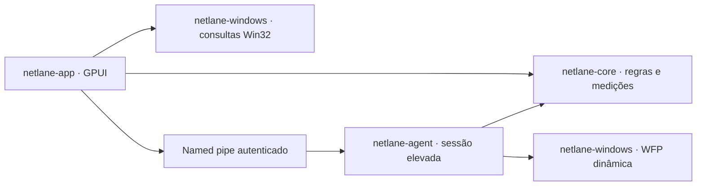

# Migração para Rust / GPUI

Em 2026-10-09 foi iniciada a migração gradual autorizada, com uma prévia local
0.4.0. O novo painel, domínio, monitor Win32 e agente de sessão são Rust.
A solução `NetLane.sln` permanece como referência e fallback enquanto os
gates de equivalência e runtime não estiverem concluídos. O instalador atual
continua publicando a implementação .NET; este trabalho não altera o produto
instalado nem sua inicialização.

## Arquitetura



| Crate | Responsabilidade |
| --- | --- |
| `netlane-core` | JSON compatível, campos desconhecidos, SHA-256, gravação atômica/backup, seleção de interface, auxiliares Steam, contadores e transações simuláveis |
| `netlane-windows` | adaptadores/contadores/TCP IPv4/identidade de processos, ABI WFP, sessão dinâmica, ACL/identidade de peers e opções temporárias |
| `netlane-agent` | validação e plano sem elevação; sessão explícita com UAC, heartbeat, owner PID/data de criação, limpeza e exclusão de concorrência com .NET |
| `netlane-app` | navegação, cartões, conexões pesquisáveis, regras, diagnóstico e preferências de aparência |

A interface segue o termIAX: GPUI na mesma revisão, Segoe UI, JetBrains Mono,
Material Symbols e cores por tokens de tema. Há 13 temas (NetLane Dark, One,
One Dark Pro, Ayu e Gruvbox), busca, prévia ao navegar, confirmação com Enter
e cancelamento com Esc. Tema, texto de 10–20 px e densidade são persistidos.
As cinco telas são Visão geral, Conexões, Regras, Diagnóstico e Configurações.

O painel coleta a cada dois segundos, sem elevação e sem enviar sondagens de
rede. As conexões observadas são TCP/IPv4 estabelecidas; saída observada não
prova causalidade do roteamento e não é contagem de bytes por aplicativo.
Os totais por interface incluem todos os aplicativos e somente intervalos
medidos. Falha, reset de contador e pausa longa invalidam a taxa daquele trecho.

## Compilar e abrir

Requer Windows x64, Rust 1.98.1 e ferramentas MSVC/Windows SDK. A versão Rust
está em `rust-toolchain.toml`; dependências e revisões estão fixadas no lockfile.
A GUI é incluída com `--workspace` (os membros padrão são as crates sem GUI).

```powershell
cargo build --workspace --release --locked
& .\artifacts\rust-target\release\netlane.exe --demo
```

`--demo` usa dados fictícios, não cria controlador de roteamento e não consulta
a rede nem o perfil instalado. Alterações de regras ficam em memória; aparência
fica em `%TEMP%\NetLane-Rust-Demo`. Não inicie uma sessão para validar a prévia.

Para criar uma pasta com os dois executáveis, documentação, avisos e atalho de
demonstração, sem instalar:

```powershell
.\scripts\build-rust-preview.ps1
```

Uma abertura normal usa `%LOCALAPPDATA%\NetLane-Rust` e começa em observação.
`--profile C:\PastaAbsoluta` permite um perfil próprio. Não aponte uma prévia
para dados instalados ou regras do checkout. Aparência usa `appearance.json`;
regras usam `netlane-rules.json`; seleção do painel usa `interface-selection.json`.

## Importar regras

No perfil Rust vazio, **Regras → Importar regras JSON** abre o seletor de arquivo.
O arquivo escolhido é validado e lido sem gravação; o usuário revisa as regras
e clica **Salvar alterações** para criar a cópia no perfil Rust. Não há importação
automática do produto instalado. Campos adicionais, GUIDs salvos e preferências
de auxiliares são preservados. Há controle de revisão e backup na gravação.

O leitor aceita nomes de propriedades sem distinção de caixa, modos numéricos
ou texto e BOM UTF-8. A comparação com .NET cobre oito fixtures documentadas
no script; não é uma prova de equivalência para todo JSON possível. Campos
conhecidos repetidos com caixas diferentes são recusados em Rust. Regras antigas
sem caminho executável precisam ser associadas a um `.exe` local para aplicação.
Use **Escolher .exe** na própria regra; o modo, a interface e os campos adicionais
permanecem preservados até salvar a edição no perfil Rust.
Uma interface escolhida explicitamente não é substituída silenciosamente.

## Validação local

```powershell
cargo fmt --all -- --check
cargo test --workspace --locked
cargo clippy --workspace --all-targets --locked --features netlane-app/gui-test -- -D warnings
.\scripts\verify-rust-compatibility.ps1
.\scripts\verify-rust-ui.ps1
dotnet build NetLane.sln --configuration Release
dotnet test NetLane.sln --configuration Release --no-build
```

A comparação requer .NET SDK 8 e um build Release do agente Rust. Usa somente
fixtures sob `artifacts`, compara conteúdo normalizado e verifica SHA-256 do
original. Os testes Rust usam sessões WFP e opções simuladas; o teste de pipe
usa um nome aleatório privado, autentica PID real e não lança agente/UAC/WFP.

A prova visual compila com `gui-test`, abre **somente demonstração**, captura
12 cenas reais pela GPU GPUI, verifica prévia/cancelamento/confirmação e releitura
do tema do disco, edita/salva uma regra em memória e encerra com código zero.
Também captura fonte máxima, lista compacta e estado vazio na janela mínima.
O script recusa evidências anteriores e exige hashes distintos das 12 imagens.
A inspeção humana dos PNGs complementa as asserções; hash distinto sozinho não
prova layout correto. O build comum exclui o capturador.

Resultados desta rodada (2026-10-09/10): **26 testes Rust**, **283 testes .NET**,
oito fixtures diferenciais aprovadas e 12 cenas GPUI distintas, com código de
saída zero. Build Release, formatação e Clippy sem avisos passaram. O monitor
Rust também leu adaptadores e conexões reais sem iniciar uma sessão de roteamento;
isso valida a coleta local, não a aplicação de políticas. Evidências sob
`artifacts/rust-ui-complete-20261010`, `artifacts/rust-compatibility` e
`artifacts/rust-readonly-monitor`; prévia comum em `artifacts/rust-preview-20261010-v2`.

## Gates para substituir a versão .NET

| Etapa | Estado nesta migração |
| --- | --- |
| Domínio, persistência e monitor | implementados; testes locais e fixtures de compatibilidade |
| GUI GPUI e temas | implementados; prova visual local em dados fictícios |
| Agente elevado/WFP/limpeza | implementado e compilado; canal/controle testados sem políticas reais |
| Bandeja, inicialização com Windows e ícones por processo | port ainda pendente; X na prévia Rust solicita saída segura |
| Qualidade por conexão e alteração da conexão padrão | port ainda pendente; nenhum ensaio ou alteração de métrica realizado |
| Runtime de roteamento, suspensão, perda de interface, QUIC/IPv6 | QA específico pendente; evidência antiga da implementação .NET não valida o port |
| Instalador, upgrade/remoção, assinatura e publicação | adaptação/validação pendentes; procedimentos atuais continuam valendo |
| Licenças transitivas e entrega pública | revisão final pendente |

Não considerar esta prévia uma substituição completa da versão instalada.
Antes do cutover, portar as funções restantes e executar os ensaios autorizados
com baseline e reversão. `Stopped` com limpeza confirmada é obrigatório para
permitir outra sessão; simples saída do processo não confirma restauração.
Nenhuma execução elevada, política real, mudança de rotas/métricas/bindings IPv6,
instalação, assinatura, commit ou push faz parte desta validação.
