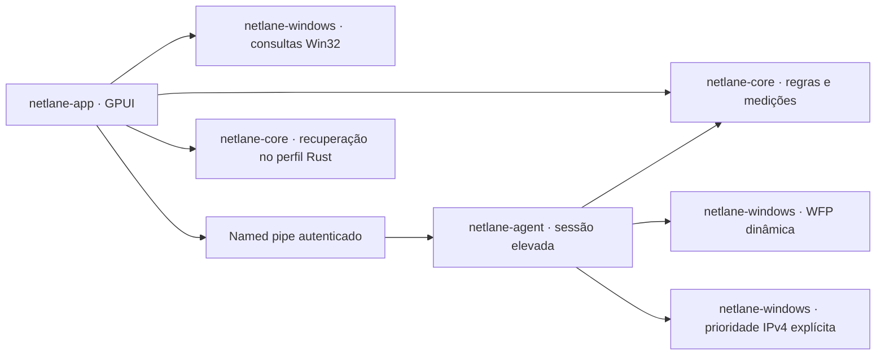

# Migração para Rust / GPUI

Em 2026-10-09 foi iniciada a migração gradual autorizada, com uma prévia local
0.4.0. O novo painel, domínio, monitor Win32 e agente de sessão são Rust.
A solução `NetLane.sln` permanece como referência e fallback enquanto os
gates de equivalência e runtime não estiverem concluídos. O instalador atual
continua publicando a implementação .NET; este trabalho não altera o produto
instalado nem sua inicialização.

## Arquitetura



| Crate | Responsabilidade |
| --- | --- |
| `netlane-core` | JSON compatível, campos desconhecidos, SHA-256, gravação atômica/backup, seleção de interface, auxiliares Steam, contadores e transações simuláveis |
| `netlane-windows` | adaptadores/contadores/TCP IPv4/identidade de processos, ABI WFP, sessão dinâmica, ACL/identidade de peers e opções temporárias |
| `netlane-agent` | validação e plano sem elevação; sessão explícita com UAC, heartbeat, owner PID/data de criação, limpeza e exclusão de concorrência com .NET |
| `netlane-app` | navegação, cartões, conexões pesquisáveis, regras, diagnóstico e preferências de aparência |

A interface segue o termIAX: GPUI na mesma revisão, Segoe UI, JetBrains Mono,
Material Symbols e cores por tokens de tema. Há 13 temas (NetLane Dark, One,
One Dark Pro, Ayu e Gruvbox), busca, prévia ao navegar, confirmação com Enter
e cancelamento com Esc. Tema, texto de 10–20 px e densidade são persistidos.
As cinco telas são Visão geral, Conexões, Regras, Diagnóstico e Configurações.

O painel coleta a cada dois segundos, sem elevação e sem enviar sondagens de
rede. As conexões observadas são TCP/IPv4 estabelecidas; saída observada não
prova causalidade do roteamento e não é contagem de bytes por aplicativo.
Os totais por interface incluem todos os aplicativos e somente intervalos
medidos. Falha, reset de contador e pausa longa invalidam a taxa daquele trecho.

## Compilar e abrir

Requer Windows x64, Rust 1.98.1 e ferramentas MSVC/Windows SDK. A versão Rust
está em `rust-toolchain.toml`; dependências e revisões estão fixadas no lockfile.
A GUI é incluída com `--workspace` (os membros padrão são as crates sem GUI).

```powershell
cargo build --workspace --release --locked
& .\artifacts\rust-target\release\netlane.exe --demo
```

`--demo` usa dados fictícios, não cria controlador de roteamento e não consulta
a rede nem o perfil instalado. Alterações de regras ficam em memória; aparência
fica em `%TEMP%\NetLane-Rust-Demo`. Não inicie uma sessão para validar a prévia.

Para criar uma pasta com os dois executáveis, documentação, avisos e atalho de
demonstração, sem instalar:

```powershell
.\scripts\build-rust-preview.ps1
```

Uma abertura normal usa `%LOCALAPPDATA%\NetLane-Rust` e começa em observação.
`--profile C:\PastaAbsoluta` permite um perfil próprio. Não aponte uma prévia
para dados instalados ou regras do checkout. Aparência usa `appearance.json`;
regras usam `netlane-rules.json`; seleção do painel usa `interface-selection.json`.

## Importar regras

No perfil Rust vazio, **Regras → Importar regras JSON** abre o seletor de arquivo.
O arquivo escolhido é validado e lido sem gravação; o usuário revisa as regras
e clica **Salvar alterações** para criar a cópia no perfil Rust. Não há importação
automática do produto instalado. Campos adicionais, GUIDs salvos e preferências
de auxiliares são preservados. Há controle de revisão e backup na gravação.

O leitor aceita nomes de propriedades sem distinção de caixa, modos numéricos
ou texto e BOM UTF-8. A comparação com .NET cobre oito fixtures documentadas
no script; não é uma prova de equivalência para todo JSON possível. Campos
conhecidos repetidos com caixas diferentes são recusados em Rust. Regras antigas
sem caminho executável precisam ser associadas a um `.exe` local para aplicação.
Use **Escolher .exe** na própria regra; o modo, a interface e os campos adicionais
permanecem preservados até salvar a edição no perfil Rust.
Uma interface escolhida explicitamente não é substituída silenciosamente.

## Bandeja e inicialização (2026-10-10)

O painel Rust usa o ícone original com `Shell_NotifyIconW` e menu nativo do
Windows. **X** e **Minimizar** ocultam a mesma janela, sem parar a sessão nem
salvar/descartar edições. Clique no ícone ou **Abrir NetLane** restaura o estado
normal/maximizado. O menu mostra sessão, contagem e edições; isso não comprova
tráfego. **Diagnóstico** e **Parar com segurança** usam os controles do painel.
**Iniciar sessão…** restaura o diagnóstico para revisar as opções e solicitar
UAC pelo botão; o menu não autoriza flags temporárias automaticamente.

**Sair** confirma edições, espera o agente e exige limpeza confirmada. Alterações
feitas durante essa espera são reconfirmadas. Uma falha de limpeza bloqueia nova
tentativa de saída; não se força o encerramento do agente. Operações/confirmações
mantêm o proprietário visível. Falha da bandeja restaura o painel e permite a
saída segura pelo X. O ícone próprio é recriado ao receber `TaskbarCreated`;
testar esse evento no componente não equivale a reiniciar o Explorer real.

Em Configurações, **Abrir com o Windows** começa desligado e fica indisponível
em demonstrações, builds de desenvolvimento, prévias e perfis alternativos.
A futura embalagem instalada deverá fornecer `netlane-rust-installed.layout`
com conteúdo `1`, ao lado de `netlane.exe`, em caminho estável. O registrador
valida caminho/argumentos e comprimento; modifica somente `NetLaneRust` em HKCU
Run, preservando o `NetLane` legado e recusando entradas Rust de outro local.
`--startup` deve ser usado sozinho: abre oculto em observação, sem iniciar agente
ou qualidade, e suprime a abertura duplicada desse mesmo executável. Se o ícone
falhar, a janela aparece. Não criar o marcador manualmente em uma prévia.
O instalador/desinstalador Rust e a remoção futura de autorun ainda estão pendentes.

Referências de implementação: [ícone nativo](https://learn.microsoft.com/en-us/windows/win32/api/shellapi/nf-shellapi-shell_notifyiconw)
e [inicialização por usuário](https://learn.microsoft.com/en-us/windows/win32/setupapi/run-and-runonce-registry-keys).

## Ícones por aplicativo (2026-10-10)

Regras e Conexões exibem o primeiro ícone do executável local em 20 px. A leitura
de recursos não executa o aplicativo. O provedor Win32 rasteriza em 32 × 32 px,
preserva transparência e libera ícones, bitmaps e contextos GDI em todos os caminhos.
As duas telas compartilham o cache; pixels iguais preservam a imagem da GPU.

A leitura ocorre em até dois trabalhos de segundo plano. Os caches nativo e GPUI
guardam até 128 executáveis cada; tamanho e data de modificação são reavaliados
ao solicitar novamente após cinco segundos. Resultados atrasados de caminhos
removidos são ignorados. Conexões solicita apenas a página visível, de até 50
linhas; em Regras, os caminhos distintos além do limite usam o marcador padrão.
Imagens removidas também são liberadas explicitamente no contexto da janela.

A consulta aceita caminhos absolutos locais `.exe`. UNC, dispositivos, unidades
de rede, arquivos offline, com recall ou reparse points — inclusive nos diretórios
ancestrais — usam o marcador padrão. Arquivos ausentes, recursos sem ícone e
falhas de leitura têm o mesmo fallback. Essas verificações são conservadoras:
um executável acessível por junction também pode aparecer sem seu ícone.
Nenhum ícone é salvo no perfil. A demonstração comum não lê ícones de executáveis;
a prova `gui-test` habilita a consulta somente para fixtures, incluindo o próprio
build e caminhos ausentes/remotos recusados antes da extração.

Referências de implementação: [extração de recursos](https://learn.microsoft.com/en-us/windows/win32/api/shellapi/nf-shellapi-extracticonexw),
[rasterização do ícone](https://learn.microsoft.com/en-us/windows/win32/api/winuser/nf-winuser-drawiconex)
e [bitmap DIB](https://learn.microsoft.com/en-us/windows/win32/api/wingdi/nf-wingdi-createdibsection).

## Qualidade por conexão (2026-10-10)

Em **Visão geral → Qualidade por conexão**, escolha Ping (IPv4) ou Site (HTTPS)
e clique **Iniciar**. A cada abertura, o monitor começa parado, inclusive com
`--startup`. Tipo/destino são as únicas preferências gravadas no perfil Rust,
em `quality-settings.json`, após preparação bem-sucedida. O leitor aceita o
formato .NET (`Mode` numérico ou texto e `Target`), sem importação automática.
As amostras ficam somente em memória. Em demonstração, Iniciar produz valores
fictícios identificados e não consulta DNS nem envia sondagens.

Cada placa recebe balão da última tentativa, ícone com cor e classificação
textual. O tooltip separa média, último valor, falhas, jitter, destino/IPv4 comum,
origem/índice e idade da atualização. As cores seguem o tema; cor sozinha não
comunica a classificação. Parar limpa os resultados e cancela a sessão; X e
Minimizar mantêm a qualidade ativa. Sair cancela o monitor antes de encerrar.
Uma chamada nativa em andamento pode terminar depois de Parar, mas seu resultado
é descartado. Os campos ficam recolhidos durante a preparação/medição.

A janela monotônica guarda até 12 tentativas concluídas em 60 segundos, exige
cinco para classificar e não conecta pares de jitter separados por falha.
Erros locais e interfaces indisponíveis não contam como tentativas perdidas.
Mudanças de GUID/LUID/IPv4, remoção/desmarcação, parada ou nova sessão invalidam
amostras e resultados em voo. Amostras vencidas deixam de produzir verde.
Há até quatro sondagens concorrentes, com intervalo mínimo de cinco segundos
por placa e prioridade para interfaces ainda sem amostra; carga pode adiar uma
nova tentativa. Resultados cancelados continuam ocupando o limite até retornar.

O provedor ICMP usa origem explícita e recusa weak-host send em interfaces
ativas ou IPv4 duplicado para evitar atribuição ambígua. HTTPS fixa origem e
`IP_UNICAST_IF`, confirma ambos após conectar, usa HEAD HTTP/1.1 com TLS mínimo
1.2 e validação Schannel de cadeia/nome. Não usa proxy, cookies nem segue
redirecionamentos; para nos cabeçalhos, limitados a 16 KiB. Qualquer status HTTP
válido conta como resposta. DNS resolve um IPv4 comum por sessão, fora do tempo
HTTPS; não mede DNS por placa. A espera lógica do DNS é de cinco segundos; o
resolver do sistema pode terminar depois, sem aplicar resultado cancelado.
ICMP tem timeout de três segundos e o socket HTTPS compartilha prazo de três
segundos para conexão/I/O; validação nativa de certificados precisa de QA real.

As heurísticas de Ping/HTTPS e sua interpretação seguem a
[referência .NET](qualidade-conexao.md#medidas-e-interpretação). ICMP pode ser
filtrado; ausência de ping não afirma queda da Internet. Falhas HTTPS incluem
TLS/protocolo e não representam perda de pacotes. A função mede o caminho até
o alvo escolhido, sem mudar rotas, métricas, DNS, IPv6 ou regras dos aplicativos.

Referências: [ICMP com origem](https://learn.microsoft.com/en-us/windows/win32/api/icmpapi/nf-icmpapi-icmpsendecho2ex),
[interface por socket](https://learn.microsoft.com/en-us/windows/win32/winsock/ipproto-ip-socket-options)
e [SNI/validação TLS](https://docs.rs/native-tls/0.2.18/native_tls/struct.TlsConnector.html).

## Conexão padrão (2026-10-10)

**Visão geral → Conexão padrão · IPv4** mostra a prioridade observada, permite
selecionar cabo/Wi-Fi, atualizar a leitura, aplicar e restaurar a configuração
anterior. Selecionar não grava métricas. Aplicar/Restaurar abrem confirmação;
na execução normal, o comando limitado do agente irmão solicita UAC. Abertura,
`--startup` e atualização apenas leem; não há reaplicação automática.
Demonstração simula a troca/restauração em memória, identificada no painel,
sem PowerShell, UAC, perfil real ou arquivo de recuperação.

O port preserva o cálculo da [referência .NET](conexao-padrao.md): soma da
métrica de rota e interface, prioridade manual 5 para a escolhida e alternativas
acima do total escolhido. VPN concorrente, destino desconectado, lista inválida,
identidade/rotas alteradas e diferença entre configuração ativa e salva causam
recusa. Interfaces físicas sem participação na escolha ficam fora da gravação.
A leitura inclui rotas padrão de outras interfaces para detectar concorrência.

`default-connection.json` fica somente no perfil Rust. O formato Original,
Applied, Previous e os campos de métrica são compatíveis com o registro .NET;
campos adicionais da raiz são preservados, sem importação automática. Gravação
atômica com backup, revisão e trava por operação guarda os primeiros originais
antes do UAC. Trocas posteriores mantêm esses originais. Arquivo inválido,
maior que 64 KiB, removido/alterado externamente ou interface ausente bloqueiam
a operação, sem substituir o registro. Cancelamento de autorização mantém um
registro pendente; Restaurar pode eliminá-lo sem UAC se os originais já estiverem
ativos. Não há restauração automática ao sair. O backup permanece como evidência;
o leitor não o reaplica automaticamente após apagar o registro principal.

O comando `--default-connection-session` é independente do WFP e compartilha
com .NET a exclusão `NetLane.DefaultConnection.v1`. O canal local autentica PID
exato nas duas pontas e PID/data de criação do proprietário; exige token elevado
e um handshake próprio antes de receber mudanças. Nenhum caminho de recuperação
entra no agente elevado. Alternativas são elevadas antes de reduzir a escolhida;
identidade/prioridade são relidas antes de cada escrita. Falha parcial tenta
reverter em ordem inversa, incluindo atualização parcial de estado ativo/salvo,
e confere a reversão. Valores externos desconhecidos são preservados.

Perda do canal ou da janela antes do reconhecimento provoca tentativa de
reversão. O painel exige resposta, reconhecimento final, término do componente
com código zero para sucesso e uma nova leitura antes de finalizar o registro.
Perda após reconhecimento conserva o registro pendente para recuperação.
Sair, X, Minimizar e iniciar/parar a sessão ficam bloqueados durante a operação;
uma sessão WFP já ativa pode continuar. A gravação usa apenas GUID/inteiro em
scripts fixos e módulos de sistema NetAdapter/NetTCPIP, via Windows PowerShell
embutido. Não embarca o runtime .NET 8 do produto antigo. O provedor não muda
gateway, DNS, estado das placas, IPv6, firewall ou `routepolicies`.

O [Set-NetIPInterface](https://learn.microsoft.com/en-us/powershell/module/nettcpip/set-netipinterface?view=windowsserver2025-ps#-policystore)
sem PolicyStore atualiza os estados ativo e persistente; a soma de métricas segue
a [documentação do Windows](https://learn.microsoft.com/en-us/windows-server/networking/technologies/network-subsystem/net-sub-interface-metric).
O port relê ambos. Prazo de 25 s do provedor e prazos de IPC são lógicos: um
escritor CIM em andamento não é morto, para evitar corrida com a reversão. Um
provedor travado pode manter a operação ocupada; duração, cancelamento, UAC,
restauração real e persistência após reboot exigem QA autorizado separado.
Nenhuma prioridade aplicada é prova de tráfego ou acesso à Internet.

## Validação local

```powershell
cargo fmt --all -- --check
cargo test --workspace --locked
cargo clippy --workspace --all-targets --locked --features netlane-app/gui-test -- -D warnings
.\scripts\verify-rust-compatibility.ps1
.\scripts\verify-rust-ui.ps1
dotnet build NetLane.sln --configuration Release
dotnet test NetLane.sln --configuration Release --no-build
```

A comparação requer .NET SDK 8 e um build Release do agente Rust. Usa somente
fixtures sob `artifacts`, compara conteúdo normalizado e verifica SHA-256 do
original. Os testes Rust usam sessões WFP e opções simuladas; o teste de pipe
usa um nome aleatório privado, autentica PID real e não lança agente/UAC/WFP.

A prova visual compila com `gui-test`, abre **somente demonstração**, captura
21 cenas reais pela GPU GPUI, verifica prévia/cancelamento/confirmação e releitura
do tema do disco, edita/salva uma regra em memória e encerra com código zero.
Também captura fonte máxima, lista compacta e estado vazio na janela mínima.
O script recusa evidências anteriores e exige hashes distintos das 21 imagens.
A inspeção humana dos PNGs complementa as asserções; hash distinto sozinho não
prova layout correto. O build comum exclui o capturador.

Na etapa de conexão padrão de 2026-10-10: **66 testes Rust aprovados**
(10 agente, 9 app, 25 core e 22 Windows), formatação, Clippy comum/com `gui-test`
e build Release aprovados. Testes novos cobrem troca Wi-Fi → cabo → restauração,
originais persistentes, prioridades de rota, VPN concorrente, cancelamento,
falha parcial nos dois estados, reversão incompleta, proteção de edição externa,
identidade/rotas obsoletas, registro .NET, corrupção/limite/revisão e reabertura.
IPC em memória cobre componente antigo, falso sucesso, canal sem reconhecimento,
proprietário encerrado e ausência de recibo final. Testes do provedor conferem
scripts/limites em memória, sem executar PowerShell para escrever métricas.

A prova GPU passa nas 21 cenas, incluindo confirmação, Wi-Fi aplicada/restaurada
em simulação e bloqueio de saída/minimização. Capturas claro/escuro e janela
mínima de 1000×640 revisadas; conteúdo abaixo dos controles usa rolagem vertical.
Evidências finais: `artifacts/rust-default-ui-20261010-final`; as duas provas anteriores
também passaram e foram preservadas antes de reforçar identidade/revisão.
Prévia comum: `artifacts/rust-preview-default-20261010`, sem capturador/marcador
de instalação. Não houve UAC, escrita real de métricas, sessão WFP, sondagem,
alteração de autorun/IPv6 ou acesso ao perfil instalado. QA real continua pendente.

Na etapa de qualidade de 2026-10-10: **47 testes Rust aprovados** (5 agente,
7 app, 15 core e 20 Windows). Os novos testes cobrem alvos/preferências .NET,
classificação por protocolo, expiração, jitter, erros locais, parada/reinício,
mudança de IP, desmarcação/reseleção, resultados atrasados, concorrência e justiça
do agendamento. As rotinas Windows foram compiladas; testes de ICMP/HTTPS usam
interpretação de respostas, cabeçalhos em memória e cancelamento antes de I/O.
A prova GPU gera 18 cenas, incluindo início/parada, Ping/HTTPS fictícios, janela
mínima e componente de detalhes do tooltip. A prova de bandeja confirma que
ocultar preserva a qualidade ativa. Hover real pelo mouse, APIs na rede,
cancelamento nativo sob carga, DHCP/perda de placa e outros DPI são QA separado.
Evidências finais sob `artifacts/rust-quality-ui-20261010-v2`; a primeira prova
foi preservada após uma asserção de tema no roteiro, corrigida na segunda. Prévia em
`artifacts/rust-preview-quality-20261010`. Nenhuma sondagem real, DNS de alvo,
UAC, WFP, mudança de autorun ou acesso ao perfil instalado nesta validação.

Na etapa dos ícones de 2026-10-10: **36 testes Rust aprovados** (5 agente, 6 app,
9 core e 16 Windows). Testes adicionais cobrem deduplicação concorrente, limite
do cache, alteração do arquivo, conclusão atrasada, reuso de imagem, fallback,
alpha/máscara e 32 ciclos de rasterização com contagens GDI/USER iguais antes e
depois. Formatação, Clippy comum e com `gui-test`, e build Release passaram.
A prova GPU verificou o ícone real do próprio build, mesma imagem nas duas telas
e fallback imediato ao editar para UNC. Gerou 14 capturas; a revisão visual de
Regras/Conexões cobriu tema claro/escuro, janela mínima e fallback. Os cenários
de bandeja/saída também passaram.
Evidências sob `artifacts/rust-icons-ui-20261010`; prévia comum sem capturador em
`artifacts/rust-preview-icons-20261010`. Outros executáveis, outras escalas e o
produto instalado ainda precisam de QA específico. Nenhuma sessão de rede,
autorun real, UAC ou alteração do perfil instalado fez parte desta etapa.

Na etapa de bandeja de 2026-10-10: **30 testes Rust aprovados**. As verificações
cobrem registro em subárvore HKCU descartável, recusa de outro caminho, preservação
do valor legado, mutex de presença e reconfirmação da saída. A prova GPUI também
exercita HWND real e callbacks da bandeja: abertura inicialmente oculta,
X/minimizar/restaurar, estado maximizado, mesma regra/edições, cancelamento de Sair,
recriação do ícone próprio, fallback após falha e edição durante parada simulada.
Nenhum valor real de Run foi gravado e nenhuma sessão WFP foi aberta. Logon real,
menu pelo mouse, outras escalas, reinício real do Explorer e runtime com agente
elevado permanecem QA separado. Falha ao reler o arquivo salvo antes de descartar
mantém as edições. Evidências finais sob `artifacts/rust-tray-ui-20261010-final`;
prévia comum em `artifacts/rust-preview-20261010-final`.

Resultados da primeira rodada (2026-10-09/10): **26 testes Rust**, **283 testes .NET**,
oito fixtures diferenciais aprovadas e 12 cenas GPUI distintas, com código de
saída zero. Build Release, formatação e Clippy sem avisos passaram. O monitor
Rust também leu adaptadores e conexões reais sem iniciar uma sessão de roteamento;
isso valida a coleta local, não a aplicação de políticas. Evidências sob
`artifacts/rust-ui-complete-20261010`, `artifacts/rust-compatibility` e
`artifacts/rust-readonly-monitor`; prévia comum em `artifacts/rust-preview-20261010-v2`.

## Gates para substituir a versão .NET

| Etapa | Estado nesta migração |
| --- | --- |
| Domínio, persistência e monitor | implementados; testes locais e fixtures de compatibilidade |
| GUI GPUI e temas | implementados; prova visual local em dados fictícios |
| Agente elevado/WFP/limpeza | implementado e compilado; canal/controle testados sem políticas reais |
| Bandeja e saída segura | port implementado; provas locais com HWND/callbacks reais e sessão simulada |
| Inicialização com Windows | registrador implementado/testado em chave temporária; disponível só no futuro pacote instalado; logon/remoção pendentes |
| Ícones por processo | implementados; cache/recursos testados e prova GPU com executável do próprio build; QA instalado pendente |
| Qualidade por conexão | lógica/controles/provedores portados; testes e prova GPU com simulações; sondagens Windows reais e hover/DPI pendentes |
| Alteração/restauração da conexão padrão | lógica, recuperação, painel e comando portados; simulações aprovadas; UAC/métricas/reboot reais pendentes |
| Runtime de roteamento, suspensão, perda de interface, QUIC/IPv6 | QA específico pendente; evidência antiga da implementação .NET não valida o port |
| Instalador, upgrade/remoção, assinatura e publicação | adaptação/validação pendentes; procedimentos atuais continuam valendo |
| Licenças transitivas e entrega pública | revisão final pendente |

Não considerar esta prévia uma substituição completa da versão instalada.
Antes do cutover, portar as funções restantes e executar os ensaios autorizados
com baseline e reversão. `Stopped` com limpeza confirmada é obrigatório para
permitir outra sessão; simples saída do processo não confirma restauração.
Nenhuma execução elevada, política real, mudança de rotas/métricas/bindings IPv6,
instalação ou assinatura faz parte desta validação. A publicação Git do código
é registrada separadamente; não constitui CI remoto, instalação ou aprovação de runtime.
